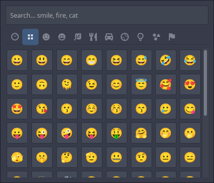
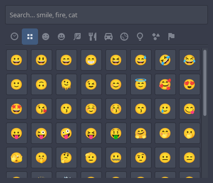
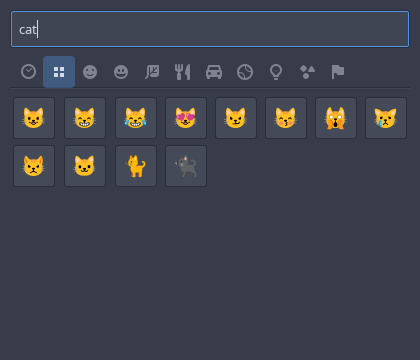
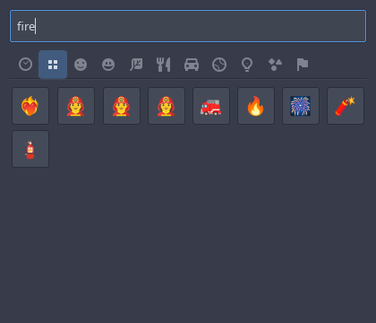
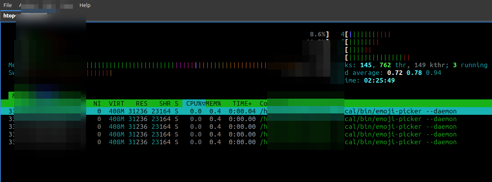
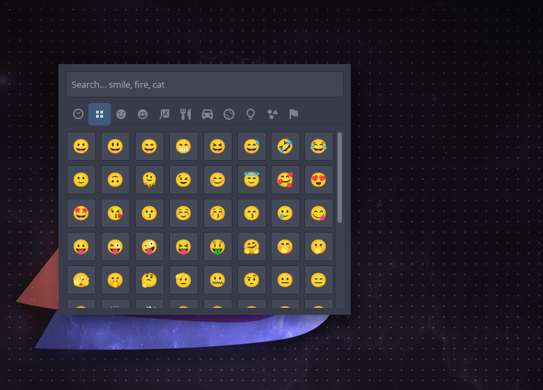

# emoji-picker


**Win+.** → pick emoji → inserts into the app you were already using.

A tiny **C + GTK3** Unicode emoji popup for Linux **X11** (Lubuntu/LXQt and friends).
No Electron. No Flatpak tax. A warm daemon so the shortcut feels instant.



      

## Why this exists

On a low-RAM desktop, “just install another Flatpak emoji app” is the wrong trade.
This project stays small, uses system GTK, and inserts into the **window that was
focused before** the picker opened — so you can keep multi-picking without fighting focus.

## Features

- Full Unicode set from official `emoji-test.txt` (refresh anytime)
- Search by name or keyword, in English or Indonesian (`fire`, `statue`,
  `ngakak`, `jempol`, …): CLDR keywords plus `data/keywords-extra.txt` for slang;
  exact name matches rank first
- Category tabs + recent history
- Skin tones: pick once, applied to every toned emoji (right-click to change);
  two-person emoji also offer mixed tones
- Popup near the pointer; skip taskbar; Esc / click-outside to dismiss
- Stays open for multi-pick (closes on Esc / outside / typing / Alt+Tab)
- Inserts via clipboard into the pre-picker window; clears clipboard after paste
- Daemon + Unix socket: `emoji-picker --toggle` from a global shortcut


## Lightweight by design

Built for low-RAM X11 desktops — not another Electron/Flatpak resident.


| Metric                                | Value                    |
| ------------------------------------- | ------------------------ |
| Binary on disk                        | **~570 KB**              |
| Emoji table (generated)               | 1923 glyphs + 2040 skin-tone variants |
| Daemon RSS (idle)                     | **~30 MB**               |
| Daemon RSS (popup open)               | **~45 MB**               |
| PSS idle / open (fairer share of GTK) | **~12 / ~18 MB**         |


Compared to the earlier naïve UI (~157 MB RSS from thousands of live widgets), the
pool + pagination design keeps the warm daemon small enough to leave running.



## Screenshots


| Browse                                            | Search                                                |
| ------------------------------------------------- | ----------------------------------------------------- |
|  |  |


Picker on the desktop (LXQt):



## Quick start

One command, no clone and no compiler. It downloads the latest prebuilt release,
checks its SHA-256 and installs it:

```bash
curl -fsSL https://raw.githubusercontent.com/habibiahmada/emoji-picker/main/get.sh | sh
```

**That's it! 🎉** Press **Win + .** (`Super+Period`) anywhere to toggle the emoji picker.

Runtime packages it needs (the installer tells you if one is missing):

```bash
sudo apt install xdotool xclip fonts-noto-color-emoji
```

### Where it goes

Everything is per-user, nothing needs `sudo`, and no download is left behind:

| What | Where |
| --- | --- |
| Binary | `~/.local/bin/emoji-picker` |
| Autostart (systemd user service) | `~/.config/systemd/user/emoji-picker.service` |
| History + saved skin tone | `~/.local/share/emoji-picker/` |
| Win+. shortcut | your desktop's own config (LXQt, Openbox, GNOME, XFCE, i3, Sway) |

### Update, uninstall, options

```bash
# Update: run the same command again
curl -fsSL https://raw.githubusercontent.com/habibiahmada/emoji-picker/main/get.sh | sh

# Uninstall
curl -fsSL https://raw.githubusercontent.com/habibiahmada/emoji-picker/main/get.sh | sh -s -- --uninstall

# Any install.sh option works after "sh -s --", e.g. skip the shortcut
curl -fsSL https://raw.githubusercontent.com/habibiahmada/emoji-picker/main/get.sh | sh -s -- --no-shortcut

# Pin a version
curl -fsSL https://raw.githubusercontent.com/habibiahmada/emoji-picker/main/get.sh | EMOJI_PICKER_VERSION=0.4.0 sh
```

Prebuilt binaries are x86_64 and built on Ubuntu 24.04 (glibc 2.39). On other
architectures or older distros, build from source.

<details>
<summary>What the installer does</summary>

1. **Checks runtime dependencies** (`xdotool`, `xclip`, color emoji font) and prints the package command if any is missing.
2. **Installs the binary** to `~/.local/bin/emoji-picker`.
3. **Configures & starts the systemd user service** with the X11 `DISPLAY` and `XAUTHORITY` drop-in.
4. **Configures the global shortcut (Win+.)** for your desktop:
   - **LXQt**: registers `Meta+period` in `globalkeyshortcuts.conf` and reloads `lxqt-globalkeysd`.
   - **Openbox**: adds `<keybind key="W-period">` to `rc.xml` and runs `openbox --reconfigure`.
   - **GNOME**: adds a custom keybinding via `gsettings`.
   - **XFCE**: configures `<Super>period` via `xfconf-query`.
   - **i3 / Sway**: appends the shortcut to the config and reloads.
5. **Verifies** the install and that the daemon is running.

You can also download the tarball from
[GitHub Releases](https://github.com/habibiahmada/emoji-picker/releases) yourself,
extract it and run `./install.sh` inside.
</details>

### From source

For hacking on the code, or on a machine without a prebuilt binary:

```bash
git clone https://github.com/habibiahmada/emoji-picker.git
cd emoji-picker
./install.sh          # builds (make data && make) if needed, then installs as above
```

The clone is only source code: the app itself still lands in `~/.local`. In a
clone, `./install.sh --update` pulls and rebuilds (`--check-update` only checks).

<details>
<summary>Build dependencies & installer options</summary>

**Installer options:**
```bash
./install.sh --help           # Show all options
./install.sh --dry-run        # Preview actions without modifying anything
./install.sh --check          # Check requirements and dependencies only
./install.sh --no-shortcut    # Skip desktop shortcut registration
./install.sh --no-service     # Skip systemd user service setup
./install.sh --uninstall      # Clean uninstallation
./install.sh --prefix=/opt    # Custom install prefix (default: ~/.local)
```

**Dependencies:**
- Debian / Ubuntu / Lubuntu:
  ```bash
  sudo apt install build-essential pkg-config libgtk-3-dev libx11-dev libfontconfig-dev xdotool fonts-noto-color-emoji xclip
  ```
- Fedora:
  ```bash
  sudo dnf install gcc make pkg-config gtk3-devel libX11-devel fontconfig-devel xdotool google-noto-color-emoji-fonts xclip
  ```
- Arch Linux / Manjaro:
  ```bash
  sudo pacman -S --needed base-devel gtk3 libx11 fontconfig xdotool noto-fonts-emoji xclip
  ```

**Manual compilation with Makefile:**
```bash
make data                     # Download Unicode & generate data tables
make                          # Compile binary
make install                  # Runs ./install.sh
```

See [docs/SHORTCUTS.md](docs/SHORTCUTS.md) for manual shortcut configuration details.
</details>

Maintainer note: ship a release with `./scripts/release.sh 0.4.0 --publish` (or push a `v*` tag).

## Usage

| Command                          | Meaning                                   |
| -------------------------------- | ----------------------------------------- |
| `emoji-picker`                   | Start (shows popup; binds socket if free) |
| `emoji-picker --daemon`          | Start hidden (systemd)                    |
| `emoji-picker --toggle`          | Show/hide (shortcut target)               |
| `emoji-picker --show` / `--hide` | Explicit show or hide                     |
| `emoji-picker --version`         | Print version information                 |
| `emoji-picker --help`            | Print CLI help and options                |

Esc or focus loss hides the window; the process keeps running.

## Update emoji database

```bash
make data    # Unicode emoji-test.txt + CLDR keyword annotations (en, id)
make && make install
```

Pin a version: `UNICODE_VER=15.1 make data` (CLDR: `CLDR_VER=release-49`).
Add everyday search words for an emoji in `data/keywords-extra.txt`.

## Docs (human-friendly)


| Doc                                          | About                                                                                   |
| -------------------------------------------- | --------------------------------------------------------------------------------------- |
| [docs/ARCHITECTURE.md](docs/ARCHITECTURE.md) | How the pieces fit                                                                      |
| [docs/DEVELOPMENT.md](docs/DEVELOPMENT.md)   | Day-to-day hacking                                                                      |
| [docs/SHORTCUTS.md](docs/SHORTCUTS.md)       | Win+. on LXQt + Openbox                                                                 |
| [docs/SCREENSHOTS.md](docs/SCREENSHOTS.md)   | How screenshots were taken                                                              |
| [docs/RELEASES.md](docs/RELEASES.md)         | GitHub Releases publish/install                                                         |
| `[.agent/](.agent/)`                         | **All** AI-agent rules & context (Cursor, Antigravity, Kiro, Copilot, Claude, Graphify) |


## Project layout

```
emoji-picker/
├── .agent/
├── Makefile                # make / make test / make install
├── pack/
├── scripts/
├── tests/
├── src/
│   ├── main.c              # daemon, socket IPC
│   ├── ui/                 # GTK shell, grid, dismiss
│   ├── model/              # search, hits, history
│   ├── insert/             # clipboard paste into apps
│   ├── platform/           # X11 helpers
│   └── generated/          # DO NOT hand-edit
└── docs/
```


## Uninstall

```bash
curl -fsSL https://raw.githubusercontent.com/habibiahmada/emoji-picker/main/get.sh | sh -s -- --uninstall
# or, in a clone: make uninstall
# optionally remove shortcut bindings from Openbox / LXQt
```


## Limitations

- **X11 only** (GTK + xclip on X). Wayland needs a different path.
- Chromium needs clipboard paste (Unicode typing is ignored); insert uses
  `windowfocus` + Ctrl+V after releasing the GTK click grab.
- Emoji newer than the installed color emoji font (e.g. Unicode 17 on Noto 2.047)
  are hidden instead of drawn as empty boxes; update the font to see them.


## Contributing

See [CONTRIBUTING.md](CONTRIBUTING.md) and [CODE_OF_CONDUCT.md](CODE_OF_CONDUCT.md).
Security reports: [SECURITY.md](SECURITY.md).

Agent / automation notes: [AGENTS.md](AGENTS.md).

## License

This project is released under the [MIT License](LICENSE).

Emoji names and glyphs are derived from Unicode’s `emoji-test.txt`, and search
keywords from Unicode CLDR annotations (both fetched at `make data`). Unicode data files are subject to the
[Unicode License](https://www.unicode.org/license.txt).

## Author

**Habibi Ahmad Aziz**

- Portfolio: [habibiahmada.dev](https://habibiahmada.dev)
- Email: [contact@habibiahmada.dev](mailto:contact@habibiahmada.dev)
- GitHub: [@habibiahmada](https://github.com/habibiahmada)


## Thanks

Thanks to everyone who contributes to this project.


Made with care for low-RAM Linux desktops.